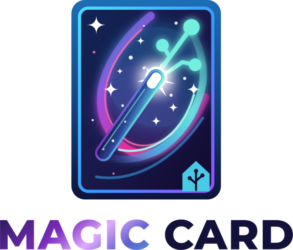

# Magic Card Utils

  

[![HACS][hacs-badge]][hacs-url]
[![GitHub Release][version-badge]][version-url]
[![GitHub License][license-badge]][license-url]
[![GitHub Last Commit][last-commit-badge]][last-commit-url]
[![GitHub Issues][issues-badge]][issues-url]

## Introduction

Magic Card Utils is the Home Assistant integration behind [Magic Card](https://github.com/therealmcsparrow/magic-card). It stores templates, icons, shapes, animations and theme presets in one place, so every dashboard shares them. Save a card once as a template, link it from any number of dashboards, and manage everything from a sidebar panel.

## Features

- **Shared templates:** save a card as a template and link it from any dashboard. Changes reach every linked card straight away.
- **Linked card tracking:** the integration counts which cards use each template and won't delete a template that's still in use.
- **Templates panel:** browse, preview, edit, duplicate and delete templates, or open one straight into the full-screen Magic Card studio.
- **Animation library:** keep the custom animations from the Magic Card animation studio in one place, for every card and every user.
- **Icon and shape library:** draw icons and shapes without a card, in the Library, Icons and Shapes tabs. Saved icons appear in Home Assistant's icon picker after a reload, and Magic Card draws them in full colour. Home Assistant's own cards show them as one-colour silhouettes.
- **Image library:** draw images in Magic Card's image editor, keep them in the Images tab and show them in image modules and background layers. Saved images are included in Home Assistant backups, and every user can see them. See [Images](documentation/panel/images.md) and the [Images section](#images) below.
- **Forum shot:** turn one of your Magic Cards into a picture to post in a forum, in light, dark or both. The picture is made in your browser. For a card with web fonts, your browser asks the font sites shown on the tab for them. See [Forum shot](documentation/panel/forum-shot.md).
- **Google Fonts:** an optional switch that gives every Magic Card font picker the full Google Fonts catalogue. Off by default. Turn it on under Settings → Devices & services → Magic Card Utils → Configure → **Load Google Fonts**, then reload the page. See [Google Fonts](documentation/google-fonts/README.md).
- **Theme presets:** keep your own theme presets in the shared library, and import or export them as files.
- **Import and export:** move icons, shapes, animations and theme presets between Home Assistant installations. Imports are size-limited and checked before anything is saved. See [Library](documentation/panel/library.md).
- **Theme editor:** create and edit Home Assistant themes in a Themes tab, with a live preview and a Try on dashboard button. Saves write the theme file to `/config/themes`.
- **Languages:** English (UK), English (US) and Dutch, following your Home Assistant profile language.
- **Templates for every user:** non-admin users see shared templates on cards too. Only admins can change them.
- **WebSocket API:** other custom cards can store and link their own templates and use the animation library.

## Requirements

- Home Assistant **2024.7** or newer.
- The integration icon and logo show in Home Assistant from **2026.3**. They also show in the Marketplace list on Home Assistant 2026.11 and newer. Older versions and the older HACS list show a placeholder.
- [Magic Card](https://github.com/therealmcsparrow/magic-card), installed through the Marketplace or HACS (or added as a dashboard resource of type JavaScript module). The panel uses the installed Magic Card; Magic Card Utils doesn't ship its own copy.
- Magic Card **2026.10.01** or newer for the Animations tab.
- Magic Card **2026.10.06** or newer for the Themes tab.
- Magic Card **2026.10.11-beta.1** or newer for the Library, Icons and Shapes tabs and for icons in Home Assistant's icon picker.
- Magic Card **2026.10.11-beta.2** or newer for template cards that non-admin users can see.
- Magic Card **2026.11.04-beta.1** or newer for the Images tab and for library images on cards.

Magic Card 2026.11.04-beta.1 meets all of these.

## Check a genuine release

Releases are built by a GitHub Actions workflow, and the Marketplace and HACS install the `magic_card_utils.zip` it attaches. Each release also carries an SBOM, `magic_card_utils.sbom.cdx.json`. You can check a download in the browser or with the GitHub CLI: see [Check a genuine release](documentation/security/check-a-genuine-release.md).

## Installation

Click the button above to open the repository on your own Home Assistant. On 2026.11 or newer it opens the Marketplace. On older versions it opens HACS, which must be installed. Install it and restart Home Assistant. Or add it by hand:

### Marketplace (Home Assistant 2026.11 or newer)

Magic Card Utils isn't in the Marketplace catalogue, so you add it by its link.

1. Go to **Settings → Marketplace**.
2. Choose **Add from link** and enter `https://github.com/therealmcsparrow/magic-card-utils`. The first time, Home Assistant asks you to accept its risk notice and to connect GitHub.
3. Install **Magic Card Utils**.
4. Restart Home Assistant.

### HACS (Home Assistant before 2026.11)

1. Open HACS in Home Assistant.
2. Open the menu (⋮) in the top right and select **Custom repositories**.
3. Add `https://github.com/therealmcsparrow/magic-card-utils` with type **Integration**.
4. Search for **Magic Card Utils** in HACS and click **Download**.
5. Restart Home Assistant.

### Manual installation

1. Download `magic_card_utils.zip` from the latest release.
2. In your Home Assistant configuration directory, make the folder `custom_components/magic_card_utils`.
3. Unpack the zip into that folder, so that `custom_components/magic_card_utils/manifest.json` exists.
4. Restart Home Assistant.

## Configuration

1. Go to **Settings → Devices & Services**.
2. Click **+ Add Integration** and search for **Magic Card Utils**.
3. Choose whether to show the side panel, then click **Submit**.

The **Magic Card Templates** panel then appears in the sidebar of admin users. It has seven tabs:

- **Templates:** every template with its card type, linked cards and last update, and buttons to open it in the studio, edit it (YAML with a live preview, then the Magic Card editor), duplicate it or delete it. Above the list you can search, export, add and import templates.
- **Library:** your saved icons, shapes, animations and theme presets, with New icon, New shape, Edit, Rename, Delete, Export and Import.
- **Animations:** the Magic Card animation studio, with the shared animation library.
- **Themes:** the Magic Card theme editor. It lists the theme files in `/config/themes`, and creates, edits, saves and deletes them. Saving needs the include lines in `configuration.yaml`, which the tab shows when they are missing. The [Magic Card theme documentation](https://github.com/therealmcsparrow/magic-card/blob/main/documentation/themes/README.md) covers the editor itself.
- **Icons:** your saved icons, with New icon, Edit, Rename, Delete and Export.
- **Shapes:** your saved shapes, each with a thumbnail and its point count, and with New shape, Edit, Rename, Delete and Export.
- **Images:** your library images, with New image, Duplicate, Rename, Delete and Export all images. Every user can see them; only admins change them.

Only admin users can create, change, rename, delete or import library items.

After an update, restart Home Assistant so your browser loads the new panel.

## Images

Library images are drawings you make in Magic Card's image editor and save to the library. Dashboards show them in an image module or as a background layer.

- Magic Card Utils stores them in Home Assistant's own storage, in `config/.storage/`. They are included in Home Assistant backups.
- Each image can be up to 1 MiB. That counts the drawing, its bindings and its animation together. The library has no limit on the number of images or on its total size, so keep an eye on how much space the images take in your backups.
- An image can carry an animation made in Magic Card's image animator. It is saved in the image itself, so every card that shows the image plays it.
- Uploaded or pasted SVG stays untrusted. Any animation inside it is removed on import, apart from the path morphs that the image editor writes itself.
- Every user who can log in to Home Assistant can see and use the images. Only administrators can create, change, rename, delete or import them.
- The Images tab lists the images. Each row has Duplicate, Rename and Delete, and Export all images saves every image to a file on your device.
- The Images tab needs Magic Card **2026.11.04-beta.1** or newer. Images over 256 KiB and animated images need the Magic Card release that matches this version. An older card still works, but it shows the large images as missing and the animated ones without motion.

A drawing can show the layout of your home, so check what goes into it. For what is stored, who can read it and what an export file holds, see the [Magic Card privacy page for images](https://github.com/therealmcsparrow/magic-card/blob/main/documentation/images/privacy.md). The [Images tab page](https://github.com/therealmcsparrow/magic-card-utils/blob/main/documentation/panel/images.md) covers the tab in detail.

## Documentation

The [documentation](https://github.com/therealmcsparrow/magic-card-utils/tree/main/documentation) covers everything in detail:

| Topic | Covers |
| --- | --- |
| [Getting started](https://github.com/therealmcsparrow/magic-card-utils/blob/main/documentation/getting-started/README.md) | Requirements, installing, setting up, updating and removing |
| [Panel](https://github.com/therealmcsparrow/magic-card-utils/blob/main/documentation/panel/README.md) | All seven tabs |
| [Forum shot](https://github.com/therealmcsparrow/magic-card-utils/blob/main/documentation/panel/forum-shot.md) | The card table, locked cards, fonts, the three looks, the privacy warning and what the area sends |
| [Library](https://github.com/therealmcsparrow/magic-card-utils/blob/main/documentation/panel/library.md) | Icons, shapes, animations and theme presets, the Icons and Shapes tabs, import and export, and the icon picker |
| [Languages](https://github.com/therealmcsparrow/magic-card-utils/blob/main/documentation/panel/languages.md) | English (UK), English (US) and Dutch, and what follows your profile language |
| [Google Fonts](https://github.com/therealmcsparrow/magic-card-utils/blob/main/documentation/google-fonts/README.md) | The Load Google Fonts switch, the font pickers, theme fonts, image text and privacy |
| [Concepts](https://github.com/therealmcsparrow/magic-card-utils/blob/main/documentation/concepts/README.md) | Templates and linking, linked-card counting, the animation library and where the data is stored |
| [WebSocket API](https://github.com/therealmcsparrow/magic-card-utils/blob/main/documentation/api/README.md) | Every command, payload, event and error code, for other custom cards |
| [Magic Card compatibility](https://github.com/therealmcsparrow/magic-card-utils/blob/main/documentation/compatibility/README.md) | Which Magic Card version each tab needs, and the version check |
| [Troubleshooting](https://github.com/therealmcsparrow/magic-card-utils/blob/main/documentation/troubleshooting/README.md) | Every panel message, its cause and the fix |

The [changelog](https://github.com/therealmcsparrow/magic-card-utils/blob/main/CHANGELOG.md) lists what changed in each release.

## Privacy

Magic Card Utils has no telemetry and sends nothing to the author. Its only request to another website is the optional Google Fonts one described below, and it is off by default. What you save stays in your own Home Assistant, in `config/.storage/` and, for themes, in `config/themes`. A file you import can point to another website; the import window tells you before you confirm. See [Importing a theme file](https://github.com/therealmcsparrow/magic-card-utils/blob/main/documentation/panel/library.md#importing-a-theme-file).

Google Fonts are off by default. You turn them on with the **Load Google Fonts** switch under Settings → Devices & services → Magic Card Utils → Configure. It covers the whole Home Assistant install, and a change applies when the page is reloaded. When it is on, the browser of everyone who views a dashboard requests font files from Google (`fonts.googleapis.com` and `fonts.gstatic.com`). Google receives the viewer's IP address, browser details and the page address, and logs the request; see [Google's privacy policy](https://policies.google.com/privacy). This includes fonts named by your active Home Assistant theme, which Magic Card Utils then loads on every Home Assistant page. When the switch is off, Magic Card Utils makes no request to Google. The switch does not cover an `@import url(https://fonts.googleapis.com/...)` that a card author typed into a card's custom css. That is an address the author chose, and the browser requests it either way.

## Support

If you have any issues with this integration, please [open an issue on GitHub](https://github.com/therealmcsparrow/magic-card-utils/issues). The [troubleshooting page](https://github.com/therealmcsparrow/magic-card-utils/blob/main/documentation/troubleshooting/README.md#reporting-a-problem) lists what to include.

Security problems: see [SECURITY.md](https://github.com/therealmcsparrow/magic-card-utils/blob/main/SECURITY.md).

If you'd like to support the project, you can buy me a coffee on [Ko-fi](https://ko-fi.com/mcsparrow) or send a donation via [PayPal](https://www.paypal.biz/therealmcsparrow).

## Contributing

Contributions are welcome! Please open an issue or a pull request on [GitHub](https://github.com/therealmcsparrow/magic-card-utils).

## License

This project is licensed under the MIT License. See the [LICENSE](https://github.com/therealmcsparrow/magic-card-utils/blob/main/LICENSE) file for details.

The MIT License covers the source code. It does not cover the brand assets (the files in `images/` and `custom_components/magic_card_utils/brand/`) or the McSparrow and Magic Card names and logos. These are not released under the MIT License.

### Third-party

- **Lit 3.3.3** (BSD-3-Clause): the panel uses a local copy in `custom_components/magic_card_utils/www/` instead of loading it from unpkg.com. The licence text is in `custom_components/magic_card_utils/www/LICENSE-lit.txt`.
- **Panel fonts** (SIL Open Font Licence 1.1): the panel loads its fonts from `custom_components/magic_card_utils/www/` and asks no outside site. The licence text is in `custom_components/magic_card_utils/www/fonts/OFL.txt`.
- **Material Design Icons, @mdi/js 7.4.47** (Apache-2.0): a few icon paths are built into `custom_components/magic_card_utils/www/mc-ui-kit.js`. The licence text is in `custom_components/magic_card_utils/www/LICENSE-mdi.txt`.

[hacs-badge]: https://img.shields.io/badge/HACS-Custom-41BDF5.svg
[hacs-url]: https://hacs.xyz/
[version-badge]: https://img.shields.io/github/v/release/therealmcsparrow/magic-card-utils?include_prereleases
[version-url]: https://github.com/therealmcsparrow/magic-card-utils/releases
[license-badge]: https://img.shields.io/github/license/therealmcsparrow/magic-card-utils
[license-url]: https://github.com/therealmcsparrow/magic-card-utils/blob/main/LICENSE
[last-commit-badge]: https://img.shields.io/github/last-commit/therealmcsparrow/magic-card-utils
[last-commit-url]: https://github.com/therealmcsparrow/magic-card-utils/commits/main
[issues-badge]: https://img.shields.io/github/issues/therealmcsparrow/magic-card-utils
[issues-url]: https://github.com/therealmcsparrow/magic-card-utils/issues
